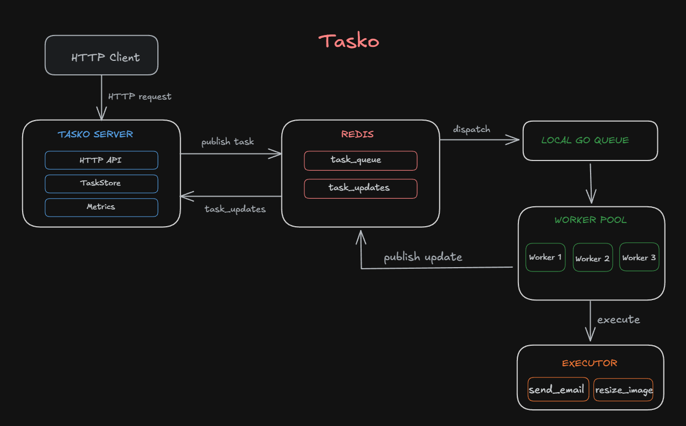

<div align="left-center">

# Tasko 

> A lightweight distributed task processing system built from scratch in Go.
> Tasko accepts tasks over HTTP, queues them through Redis, distributes them
> across concurrent workers, handles failures with retries, persists task state,
> and exposes runtime metrics.

<br>


</div>

## High-level overview



## Key features

- **Distributed task queue** backed by Redis
- **Concurrent worker pool** using Go goroutines
- **In-process buffering** with a channel-based Go queue
- **Task lifecycle tracking** — `queued`, `processing`, `completed`, `failed`
- **Automatic retries** with exponential backoff
- **Persistent task state** using an append-only JSONL log
- **Crash recovery** through log replay
- **Graceful shutdown** with context cancellation
- **Concurrent-safe state management**
- **HTTP API** for submission, tracking, listing, and metrics
- **Dockerized deployment** with Docker Compose
- **End-to-end load testing**

## Load Test

Tasko was tested with 900 concurrent task submissions and measured
end-to-end until all successfully submitted tasks reached `completed`.

| Metric | Result |
| --- | ---: |
| Requests | 900 |
| Successful | 900 |
| Failed | 0 |
| End-to-end time | ~4.83 s |
| Throughput | **~186 tasks/s** |

> Measured locally with three workers and lightweight simulated tasks.
> Throughput depends on task workload, worker count, hardware, and external
> dependencies; this is not a fixed system capacity.

Run it with:

```bash
go run ./cmd/loadtest
```

## How It Works

### 1. Submit

The HTTP server validates the request, assigns a UUID, persists the task,
and publishes it to Redis.

### 2. Dispatch

The worker process consumes tasks from Redis and places them into a buffered
local Go queue.

### 3. Execute

Workers consume tasks concurrently and execute them based on their type.

```text
send_email
resize_image
```

### 4. Retry

Failed tasks are retried up to three times with exponential backoff:

```text
2s → 4s → 8s
```

If retries remain, the task returns to the queue. If retries are exhausted,
the task is marked `failed`.

### 5. Update

Workers publish state changes through Redis. The server consumes these updates,
persists the latest task state, and updates runtime metrics.

## Task Lifecycle

```text
                 ┌───────────┐
                 │ completed │
                 └─────▲─────┘
                       │ success
┌────────┐   ┌─────────┴──────┐
│ queued ├─▶│   processing    │
└───▲────┘   └──────┬─────────┘
    │               │
    │ retry         │ retries exhausted
    └───────────────┴────▶ failed
```

On restart, tasks left in `processing` are recovered as `queued` through log
replay.

## API

The server listens on `localhost:8080`.

### Create a task

```http
POST /tasks
Content-Type: application/json
```

```json
{
  "type": "send_email",
  "payload": {
    "to": "test@example.com"
  }
}
```

```json
{
  "id": "task-id",
  "status": "queued"
}
```

Example:

```bash
curl -X POST http://localhost:8080/tasks \
  -H "Content-Type: application/json" \
  -d '{"type":"send_email","payload":{"to":"test@example.com"}}'
```

### Get a task

```http
GET /tasks/{id}
```

```json
{
  "id": "task-id",
  "type": "send_email",
  "status": "completed",
  "retryCount": 0,
  "lastError": ""
}
```

### List tasks

```http
GET /Alltasks
```

### Read metrics

```http
GET /metrics
```

```json
{
  "tasks_total": 900,
  "tasks_completed": 900,
  "tasks_failed": 0,
  "tasks_retried": 0
}
```

## Run locally

### Requirements

- Go 1.27+
- Docker
- Docker Compose

### Start the stack

```bash
docker compose up --build
```

This starts:

| Service | Role |
| --- | --- |
| `server` | HTTP API and task-state consumer |
| `worker` | Redis dispatcher and concurrent task workers |
| `redis` | Task broker and update transport |

The API is available at `http://localhost:8080`. Task state is mounted at
[`data/Tasko.log`](./data/Tasko.log).

Check service status:

```bash
docker compose ps
```

Stop the stack:

```bash
docker compose down
```

## Tests

Run the test suite:

```bash
go test ./...
```

Run with the race detector:

```bash
go test -race ./...
```

The integration test requires Redis on `localhost:6379`.

## Project Structure

```text
Tasko/
├── cmd/
│   ├── server/             # HTTP API and Redis update consumer
│   ├── worker/             # dispatcher and worker process
│   └── loadtest/           # end-to-end load-testing client
│
├── internals/
│   ├── broker/             # Redis task and update transport
│   ├── dispatcher/         # Redis-to-local-queue bridge
│   ├── executor/           # task execution
│   ├── integration/        # end-to-end integration tests
│   ├── metrics/            # atomic runtime counters
│   ├── queue/              # local queue and task states
│   ├── server/             # HTTP handlers and server setup
│   ├── taskstore/          # append-only JSONL persistence
│   └── worker/             # worker pool and retry scheduler
│
├── data/                   # runtime task log
├── docker-compose.yml
├── dockerfile
├── go.mod
└── tasko.png
```


