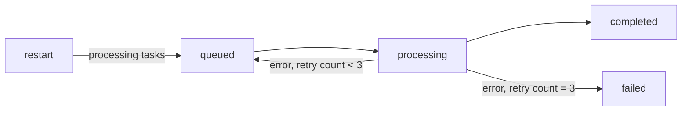

# Tasko

```text
  ┌──────────┐       ┌───────────┐       ┌────────────┐
  │  Tasko   │──────▶│  Queue    │──────▶│  Workers   │
  │  runner  │       │ buffered  │       │  × 3       │
  └────┬─────┘       └───────────┘       └─────┬──────┘
       │                                        │
       └───────────────┬────────────────────────┘
                       ▼
                 ┌───────────┐
                 │ TaskStore │
                 │ JSONL log │
                 └───────────┘
```

**Tasko is a small, durable background task runner written in Go.** It queues work, processes tasks concurrently, retries failures, and recovers unfinished work after a restart.

## What it does

- Runs three workers against a buffered in-memory queue.
- Persists task state to `Tasko.log`.
- Replays the log on startup.
- Moves interrupted `processing` tasks back to `queued`.
- Retries failed tasks up to **3 times**.
- Shuts down gracefully on `Ctrl+C` or `SIGTERM`.

## Quick start

Requires **Go 1.27.1**.

```bash
git clone https://github.com/Anshit-Gupta/Tasko.git
cd Tasko
go run ./cmd/tasko
```

The demo runner adds a few sample tasks and stays alive until it receives a shutdown signal:

```text
task completed: 1
task completed: 2
task completed: 3
task failed: 4 unknown task type :send
```

Press `Ctrl+C` to close the queue, wait for active workers, and close the task store.

## Task lifecycle



## Built-in task types

### `send_email`

```json
{
  "to": "person@example.com"
}
```

### `resize_image`

```json
{
  "image": "photo.jpg"
}
```

Task execution is selected by the task's `Type` field in [`internals/executor`](./internals/executor).

## Project layout

```text
cmd/tasko/              application entrypoint
internals/queue/        task model and buffered queue
internals/worker/       worker loop, retries, and shutdown behavior
internals/executor/     built-in task executors
internals/taskstore/    append-only JSONL persistence and recovery
Tasko.log               task history created at runtime
```

## Tests

```bash
go test ./...
```

The test suite covers persistence, log replay, recovery of interrupted tasks, corrupted log entries, and worker processing.

## Current scope

Tasko is intentionally compact and currently exposes its task setup in [`cmd/tasko/main.go`](./cmd/tasko/main.go). It is a foundation for experimenting with durable workers, not yet a general-purpose task queue or service.
